# LabTrack — Despliegue con Docker Compose

**Universidad Tecnológica del Norte de Guanajuato (UTNG)**

| Datos de la práctica | Información |
|---|---|
| Alumno | Méndez Fernández Alan Eusebio |
| Carrera | Ingeniería en Redes Inteligentes y Ciberseguridad |
| Grupo | GIRI6091 |
| Número de control | 1223100825 |
| Materia | Automatización de Infraestructura Digital I |
| Unidad | III — Interfaces de programación de aplicaciones en la automatización de redes |
| Actividad | Guía de instalación y configuración de una aplicación |
| Caso de estudio | LabTrack, sistema de préstamo de equipo de laboratorio |
| Fecha | Octubre de 2026 |

## Contenido

1. [Introducción](#1-introducción)
2. [Objetivo](#2-objetivo)
3. [Punto de partida y herramientas](#3-punto-de-partida-y-herramientas)
4. [Estructura y funcionamiento de los contenedores](#4-estructura-y-funcionamiento-de-los-contenedores)
5. [Instalación paso a paso](#5-instalación-paso-a-paso)
6. [Compilación y pruebas](#6-compilación-y-pruebas)
7. [Límites de recursos](#7-límites-de-recursos)
8. [Prueba del préstamo desde el navegador](#8-prueba-del-préstamo-desde-el-navegador)
9. [Persistencia y prueba de carga](#9-persistencia-y-prueba-de-carga)
10. [Evidencias de la práctica](#10-evidencias-de-la-práctica)
11. [Dificultades que encontré](#11-dificultades-que-encontré)
12. [Relación con la lista de cotejo](#12-relación-con-la-lista-de-cotejo)
13. [Conclusión](#13-conclusión)
14. [Referencias](#14-referencias)

---

## 1. Introducción

En la Unidad II desarrollé LabTrack, una aplicación para controlar los préstamos de equipo en un laboratorio. Ya tenía el registro de usuarios, los permisos de administrador y solicitante, el inventario y las solicitudes de préstamo. El sistema funcionaba, pero para ponerlo en marcha tenía que abrir varias terminales: una para Angular, otra para NestJS y otra para revisar PostgreSQL.

En esta unidad trabajé en una manera más ordenada de ejecutarlo. Preparé los archivos necesarios para levantar el sistema con **Docker Compose**, de modo que cada parte se ejecute en su propio contenedor y se comunique con las demás por una red interna. También configuré límites de memoria y procesador, comprobaciones de salud y un volumen para guardar la información de PostgreSQL.

Partí del código que ya había terminado en la Unidad II. No cambié la idea del sistema ni volví a programar los préstamos desde cero. Mi trabajo se centró en preparar el despliegue, solucionar los problemas que aparecieron durante la compilación y comprobar que la aplicación siguiera funcionando desde Firefox. Las capturas que agregué son de las ejecuciones que hice en mi equipo Linux.

## 2. Objetivo

Mi objetivo fue **desplegar LabTrack con Docker Compose y comprobar la comunicación entre el frontend, el backend y la base de datos**.

Para realizarlo necesitaba:

- Construir las imágenes de Angular y NestJS con sus respectivas dependencias.
- Ejecutar PostgreSQL sin mezclar sus datos con los de las otras unidades.
- Configurar la red interna, el acceso desde el navegador y las variables de entorno.
- Establecer límites de CPU, memoria y procesos para los tres servicios.
- Comprobar la API, el inicio de sesión y el préstamo completo de un equipo.
- Guardar los archivos de configuración y las evidencias para repetir el procedimiento.

## 3. Punto de partida y herramientas

Utilicé LabTrack, la aplicación que terminé en la Unidad II. Hice una copia del proyecto en otra carpeta, trabajé los cambios en la rama `unidad3-docker` y después los publiqué en la rama `main` del nuevo repositorio. Así conservé la versión anterior por separado.

| Herramienta | Uso en esta unidad |
|---|---|
| Linux | Sistema desde el que preparé y probé el despliegue |
| Docker Desktop / Docker Engine 29.9.1 | Creación y ejecución de los contenedores |
| Docker Compose v5.5.1 | Inicio y coordinación de los tres servicios |
| Node.js 20 | Compilación de Angular y NestJS dentro de las imágenes |
| npm 11.6.2 | Instalación reproducible de dependencias durante la construcción |
| Angular 21 | Interfaz de LabTrack |
| Nginx | Publicación de Angular y comunicación con la API |
| NestJS 11 | Autenticación, permisos e información de préstamos |
| Prisma 6.19.0 | Consultas y migraciones de la base de datos |
| PostgreSQL 16 | Almacenamiento de usuarios, equipos y préstamos |
| Git | Seguimiento de los cambios de esta unidad |

En mi computadora utilicé el contexto `desktop-linux`. Separé esta práctica de la banca web y de los proyectos anteriores: Compose utiliza el nombre `labtrack-unidad3`, otra red y otro volumen de datos.

### 3.1 Organización de los archivos

```text
labtrack-unidad3/
├── backend/
│   ├── Dockerfile.unidad3
│   ├── .dockerignore
│   ├── prisma/
│   │   ├── schema.prisma
│   │   └── migrations/
│   └── src/
├── frontend/
│   ├── Dockerfile.unidad3
│   ├── .dockerignore
│   ├── nginx/
│   │   └── default.conf
│   └── src/app/
├── compose.unidad3.yml
├── evidencias/
│   └── unidad3/
│       └── capturas/
├── .gitignore
└── README.md
```

El archivo `compose.yml` que venía de la Unidad II puede seguir en la carpeta, pero **para esta actividad utilicé `compose.unidad3.yml`**. Así evité arrancar por equivocación la configuración de la práctica anterior.

## 4. Estructura y funcionamiento de los contenedores

Preparé tres servicios. El navegador entra por Nginx; Nginx muestra Angular y envía las peticiones `/api/` a NestJS; NestJS utiliza Prisma para consultar PostgreSQL.

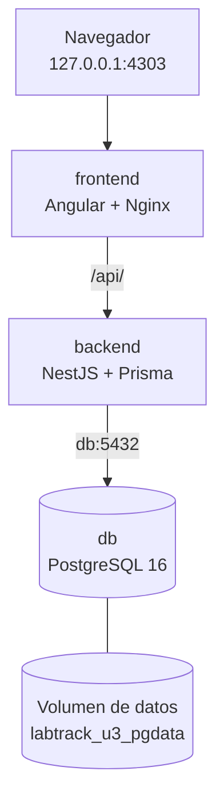

Los contenedores están conectados mediante la red `labtrack_u3_interna`. Solo el frontend publica un puerto en mi computadora (`127.0.0.1:4303`). El backend y PostgreSQL se mantienen accesibles por la red de Docker, sin publicar sus puertos hacia el host.

### 4.1 Contenedor `db`: PostgreSQL

Utilicé la imagen `postgres:16-alpine`. El servicio crea la base `labtrack_db`, utiliza el usuario `labtrack` y toma la contraseña de un archivo privado `.env.unidad3`.

En `compose.unidad3.yml` dejé configurados:

- Volumen `labtrack_u3_pgdata`, para conservar los registros.
- Red `labtrack_u3_interna`, para comunicarse con NestJS.
- Un **healthcheck** con `pg_isready`, para comprobar que PostgreSQL acepta conexiones.
- Límites de CPU, memoria y procesos.

El contenedor no tiene un `Dockerfile` propio porque utilicé directamente la imagen oficial de PostgreSQL. La configuración se encuentra en [`compose.unidad3.yml`](compose.unidad3.yml).

### 4.2 Contenedor `backend`: NestJS y Prisma

Para la API utilicé [`backend/Dockerfile.unidad3`](backend/Dockerfile.unidad3). La imagen se construye a partir de Node.js 20 y separa la etapa de compilación de la etapa de ejecución.

Durante la construcción se instalan las dependencias con `npm ci`, se genera el cliente Prisma, se compila NestJS y se ejecuta Jest. La imagen final contiene los archivos compilados, Prisma y las dependencias necesarias.

Al iniciar el contenedor se aplica `prisma migrate deploy` y después se ejecuta NestJS. La conexión utiliza `db:5432` en lugar de `localhost`, porque PostgreSQL está dentro de otro contenedor. El backend escucha internamente en el puerto **3002**.

El healthcheck consulta `/health/db`. Compose espera a que PostgreSQL esté saludable antes de iniciar el backend.

### 4.3 Contenedor `frontend`: Angular y Nginx

Preparé [`frontend/Dockerfile.unidad3`](frontend/Dockerfile.unidad3). La primera etapa utiliza Node.js para instalar las dependencias, compilar Angular y ejecutar sus pruebas con Vitest. La segunda etapa utiliza `nginx:stable-alpine` para servir los archivos estáticos.

En [`frontend/nginx/default.conf`](frontend/nginx/default.conf) configuré dos comportamientos:

- Al entrar a una ruta de Angular, Nginx entrega `index.html` para que el navegador pueda navegar por las pantallas.
- Cuando Angular llama a `/api/`, Nginx envía la solicitud a `http://backend:3002/` por la red de Docker.

También actualicé los dos servicios de Angular que tenían la dirección antigua `127.0.0.1:3002`, y después corregí el interceptor JWT para que adjuntara el token a las peticiones `/api/`.

### 4.4 Archivo de orquestación

Toda la configuración principal está en [`compose.unidad3.yml`](compose.unidad3.yml). Ahí definí los servicios `db`, `backend` y `frontend`, sus dependencias, healthchecks, límites de recursos, volumen y red.

No publiqué contraseñas dentro de Compose. Las variables que utiliza son `LABTRACK_DB_PASSWORD` y `LABTRACK_JWT_SECRET`, que se leen del archivo privado `.env.unidad3`.

## 5. Instalación paso a paso

Estos son los pasos que seguí para ejecutar el proyecto en Linux. Para repetirlos hacen falta Git, Docker Engine o Docker Desktop, Docker Compose y acceso a Internet durante la descarga de las imágenes y dependencias.

### 5.1 Descargar y entrar al proyecto

Para descargar la práctica en otra computadora, se puede clonar el repositorio público con estos comandos:

```bash
git clone https://github.com/RoxyRg/labtrack-unidad3-docker.git
cd labtrack-unidad3-docker
```

En mi computadora trabajé desde `~/proyectos/labtrack-unidad3`, porque primero había creado esa carpeta a partir del proyecto de la Unidad II. Después publiqué el código y los archivos Docker en este repositorio independiente.

### 5.2 Preparar las variables privadas

En la raíz del proyecto utilicé `.env.unidad3` para guardar la contraseña de PostgreSQL y el secreto de los JWT. Para una instalación nueva se pueden generar sin mostrarlos en la terminal:

```bash
python3 - <<'PY'
from pathlib import Path
import secrets

archivo = Path('.env.unidad3')
if archivo.exists():
    raise SystemExit('Ya existe .env.unidad3. No se sobrescribió.')

archivo.write_text(
    f'LABTRACK_DB_PASSWORD={secrets.token_hex(24)}\n'
    f'LABTRACK_JWT_SECRET={secrets.token_hex(32)}\n'
)
archivo.chmod(0o600)
print('Credenciales locales creadas.')
PY
```

Este archivo no debe subirse a GitHub. La base de datos y las cuentas que tenía en la Unidad II permanecen separadas.

### 5.3 Comprobar Docker y la configuración

```bash
docker context show
docker --version
docker compose version

docker compose --env-file .env.unidad3 \
  -f compose.unidad3.yml config --quiet
```

La validación de Compose terminó sin errores. Antes de desplegar la aplicación confirmé también que el puerto local **4303** no estaba ocupado.

### 5.4 Construir las imágenes

```bash
docker compose --env-file .env.unidad3 \
  -f compose.unidad3.yml build frontend

docker compose --env-file .env.unidad3 \
  -f compose.unidad3.yml build backend
```

Primero encontré un error de npm al construir Angular; después de corregirlo, las dos imágenes terminaron su construcción correctamente. Durante el proceso se ejecutaron la compilación y las pruebas que están definidas en los Dockerfiles.

### 5.5 Arrancar los servicios

```bash
docker compose --env-file .env.unidad3 \
  -f compose.unidad3.yml up -d

docker compose --env-file .env.unidad3 \
  -f compose.unidad3.yml ps -a
```

Al ejecutar `up -d`, Compose creó la red privada y el volumen de PostgreSQL. En la comprobación final los tres servicios aparecieron en estado **healthy**.

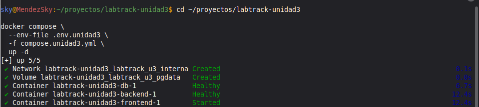

### 5.6 Comprobar la API y el frontend

Desde una terminal consulté la ruta de salud de LabTrack:

```bash
curl -i http://127.0.0.1:4303/api/health/db
```

Obtuve **HTTP 200** y una respuesta con `estado: ok` y el nombre `labtrack_db`. Al principio aparecían cero usuarios porque la base nueva aún no tenía cuentas registradas.

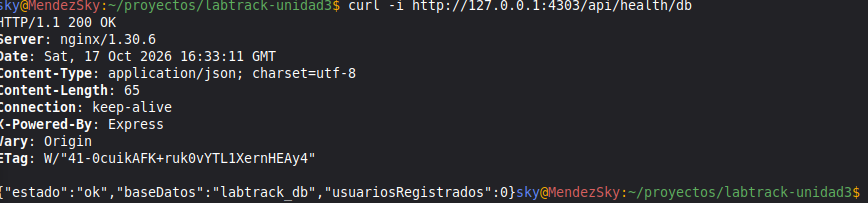

También comprobé el frontend y la protección de una ruta privada:

```bash
curl -sS -o /dev/null -w 'Frontend HTTP: %{http_code}\n' \
  http://127.0.0.1:4303/

curl -sS -o /dev/null -w 'Ruta protegida HTTP: %{http_code}\n' \
  http://127.0.0.1:4303/api/auth/me
```

El frontend respondió **200** y la ruta sin token respondió **401**, que es el comportamiento esperado.

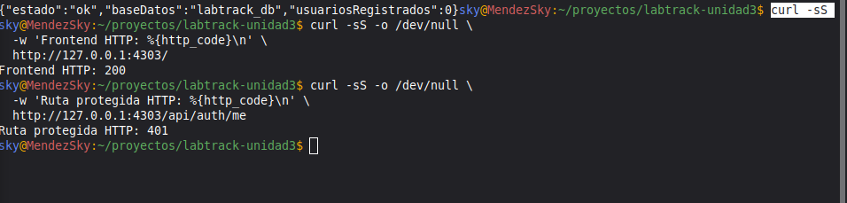

### 5.7 Acceso desde Firefox

La dirección que utilicé fue:

**http://127.0.0.1:4303**

Desde ahí pude abrir la pantalla de inicio de sesión, registrar un solicitante y entrar con una cuenta ADMIN. Para crear el administrador de una instalación nueva utilicé el script local `backend/scripts/crear_admin.cjs`, ejecutándolo en un contenedor auxiliar de Compose:

```bash
read -r -p 'Nombre del ADMIN: ' LABTRACK_ADMIN_NOMBRE
read -r -p 'Correo del ADMIN: ' LABTRACK_ADMIN_CORREO
read -r -s -p 'Contraseña ADMIN: ' LABTRACK_ADMIN_PASSWORD; echo
export LABTRACK_ADMIN_NOMBRE LABTRACK_ADMIN_CORREO LABTRACK_ADMIN_PASSWORD

docker compose --env-file .env.unidad3 \
  -f compose.unidad3.yml run --rm --no-deps \
  -v "$(pwd)/backend/scripts:/app/scripts:ro" \
  -e LABTRACK_ADMIN_NOMBRE \
  -e LABTRACK_ADMIN_CORREO \
  -e LABTRACK_ADMIN_PASSWORD \
  backend node scripts/crear_admin.cjs

unset LABTRACK_ADMIN_NOMBRE LABTRACK_ADMIN_CORREO LABTRACK_ADMIN_PASSWORD
```

No dejé contraseñas reales escritas en este documento ni las incorporé a los archivos del repositorio.

### 5.8 Detener LabTrack sin borrar información

Para apagar solamente esta práctica:

```bash
docker compose --env-file .env.unidad3 \
  -f compose.unidad3.yml down
```

**No utilizo `down -v`** porque ese comando también eliminaría el volumen de PostgreSQL y sus registros.

## 6. Compilación y pruebas

En el instrumento se solicitan pruebas de cada parte del proyecto. Estas son las comprobaciones que realicé durante la preparación del despliegue.

| Comprobación | Resultado observado |
|---|---|
| Validación de `compose.unidad3.yml` | Sin errores |
| Instalación limpia del frontend | Corregida y terminada correctamente |
| `npm run build` de Angular | Compilación exitosa |
| Vitest de Angular | 2 pruebas aprobadas |
| Construcción de la imagen frontend | Finalizada correctamente |
| Compilación y Jest de NestJS dentro de Docker | Comandos finalizados sin error de construcción |
| Construcción de la imagen backend | Finalizada correctamente |
| Estado de los tres contenedores | Los tres llegaron a `healthy` |
| `GET /api/health/db` | HTTP 200 |
| `GET /` | HTTP 200 |
| `GET /api/auth/me` sin JWT | HTTP 401 |
| Acceso al sistema desde Firefox | Login, inventario y préstamos visibles |

Las **dos pruebas de Vitest** comprueban el componente principal de Angular y la prueba de **Jest** revisa una ruta básica de NestJS. El resto de las operaciones, como el préstamo y la devolución, las probé por separado desde la API y el navegador.

## 7. Límites de recursos

En el archivo Compose establecí límites para que los contenedores no utilicen todos los recursos de mi equipo.

| Servicio | CPU máximo | Memoria máxima | Límite de procesos |
|---|---:|---:|---:|
| `frontend` | 0.5 CPU | 128 MiB | 128 |
| `backend` | 1 CPU | 768 MiB | 256 |
| `db` | 0.75 CPU | 512 MiB | 200 |

Para ver el consumo ejecuté:

```bash
docker stats --no-stream \
  $(docker compose --env-file .env.unidad3 \
    -f compose.unidad3.yml ps -q)
```

En una de mis mediciones obtuve estos valores:

| Servicio | Memoria utilizada | Límite de memoria | Porcentaje |
|---|---:|---:|---:|
| `backend` | 86.25 MiB | 768 MiB | 11.23 % |
| `db` | 28.79 MiB | 512 MiB | 5.62 % |
| `frontend` | 15.93 MiB | 128 MiB | 12.44 % |

Los tres estaban por debajo del límite de memoria. Esta lectura corresponde a ese momento de la práctica; no significa que el consumo sea siempre igual.

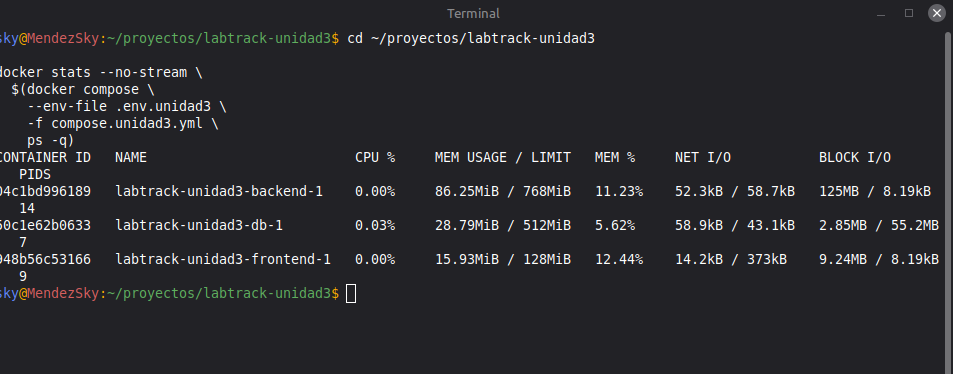

## 8. Prueba del préstamo desde el navegador

Con los tres servicios activos, entré al sistema en Firefox y repetí el recorrido del préstamo que había trabajado durante la Unidad II.

**Primero entré como ADMIN.** Abrí las pantallas de categorías y equipos y comprobé que podía administrar el inventario. Registré material para trabajar con un equipo disponible.

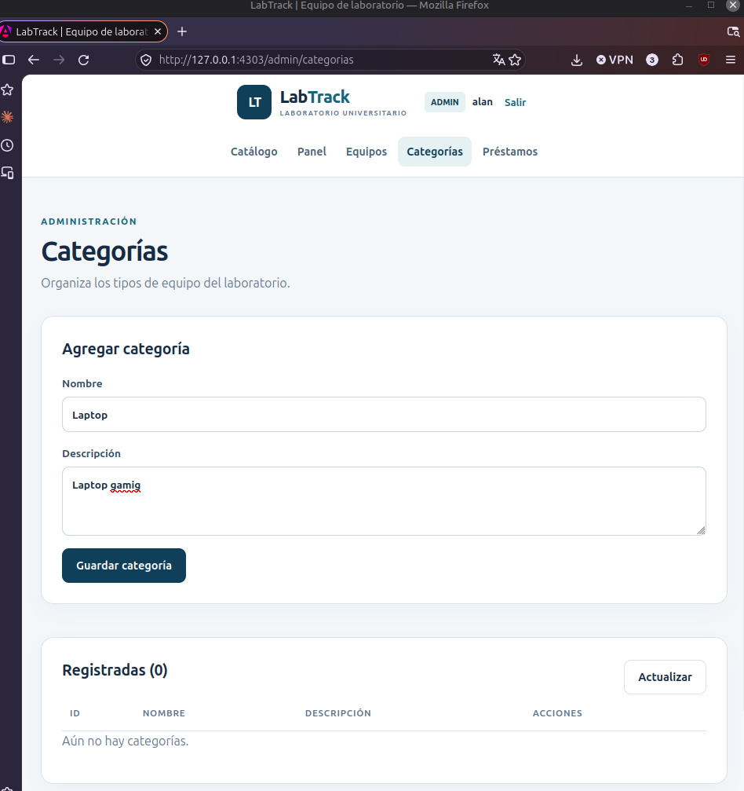

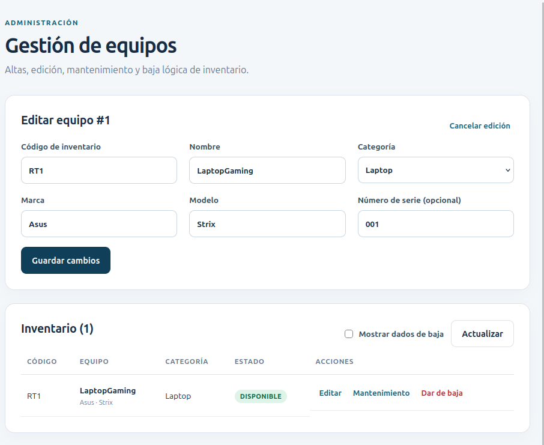

**Después entré como SOLICITANTE.** Revisé el catálogo, seleccioné el equipo, elegí las fechas y escribí el motivo del préstamo. La solicitud quedó pendiente y se mostró en mi historial.

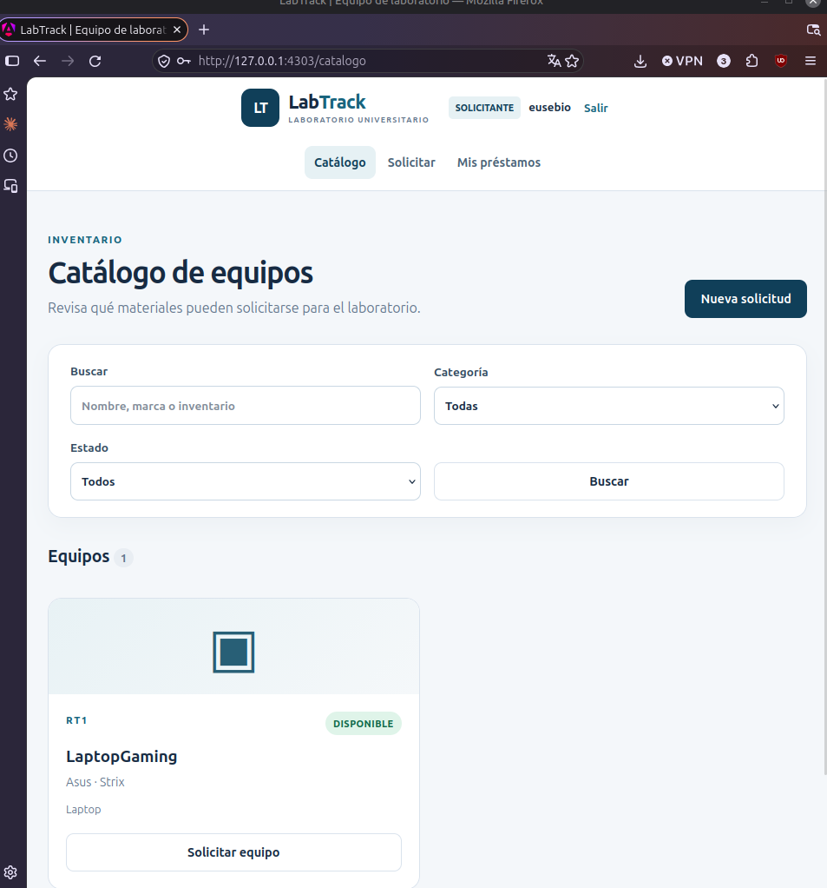

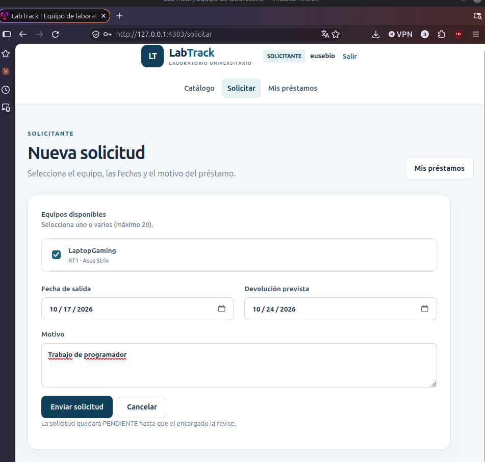

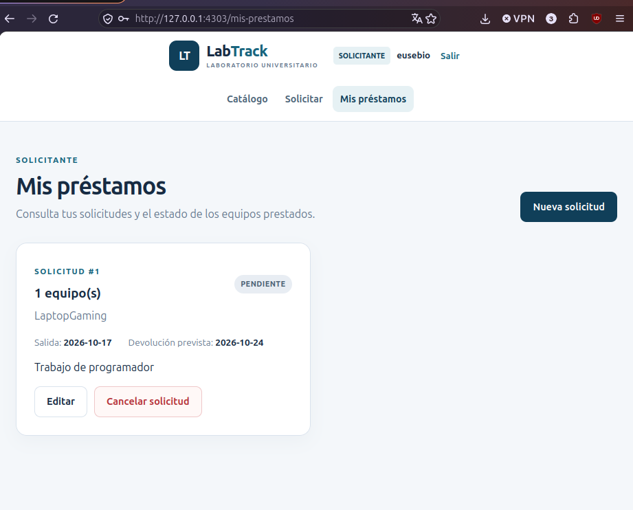

También abrí el formulario para editar una solicitud mientras seguía pendiente.

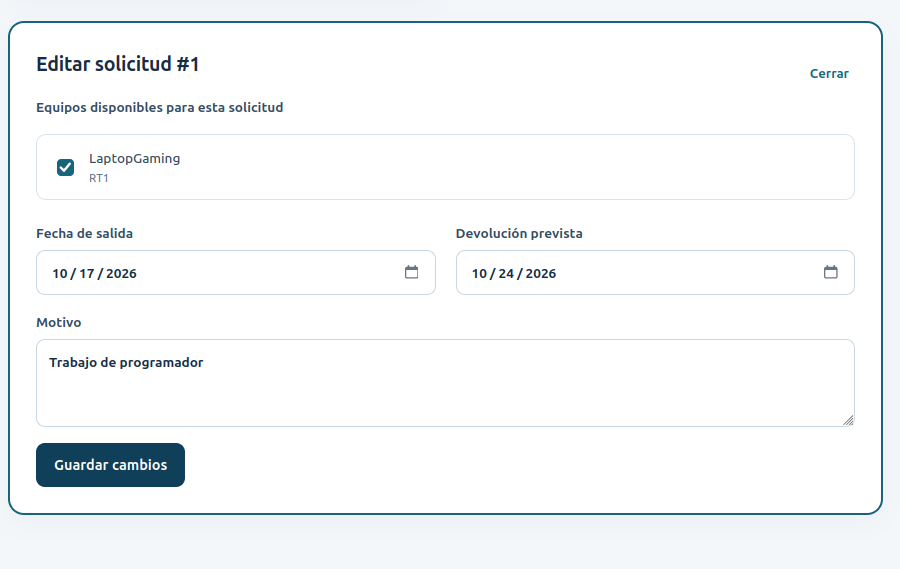

**Finalmente volví a entrar como ADMIN.** En Gestión de préstamos comprobé que la solicitud aparecía pendiente. La aprobé, registré la entrega y después la devolución.

| Paso | Estado que vi | Disponibilidad esperada del equipo |
|---|---|---|
| Solicitud nueva | `PENDIENTE` | `DISPONIBLE` hasta su aprobación |
| Aprobación | `APROBADO` | `RESERVADO` |
| Entrega | `ENTREGADO` | `PRESTADO` |
| Devolución | `DEVUELTO` | `DISPONIBLE` |

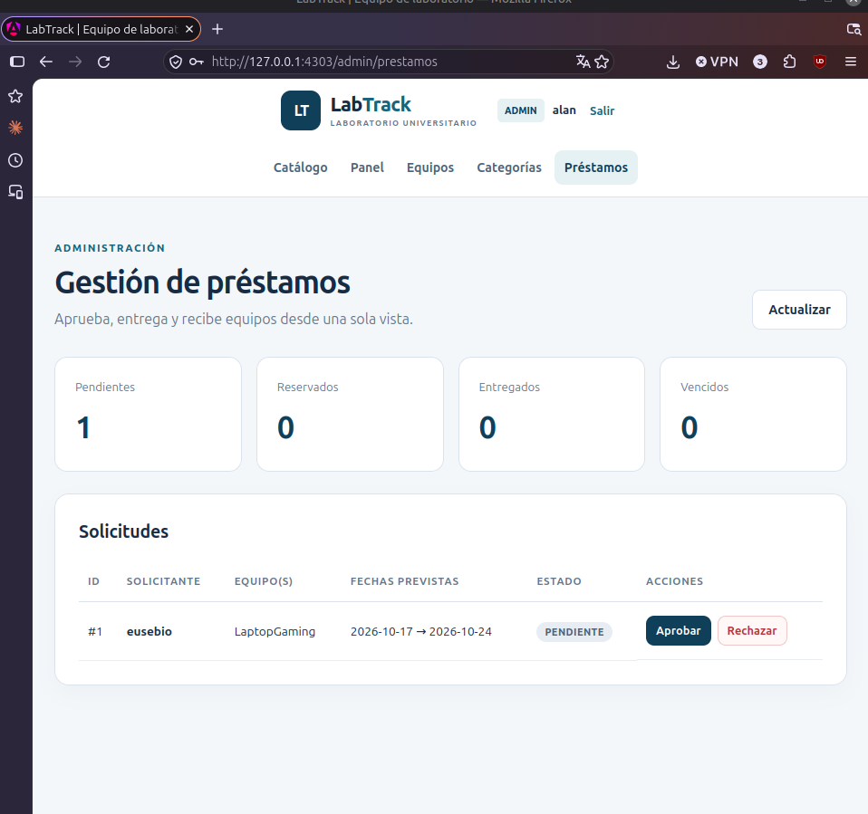

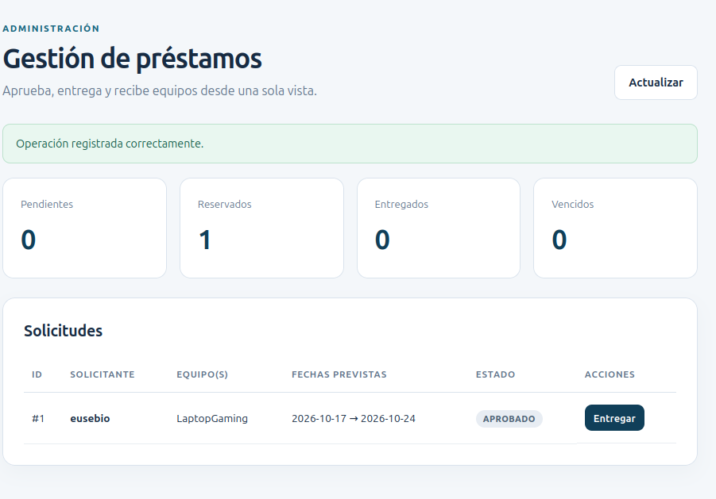

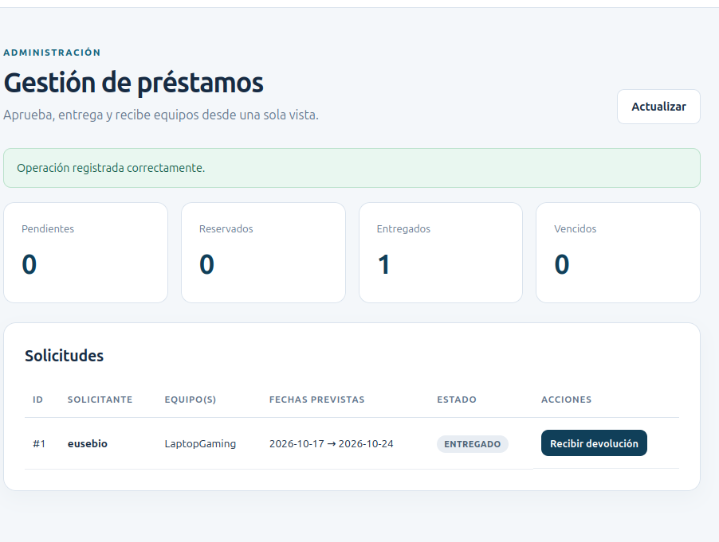

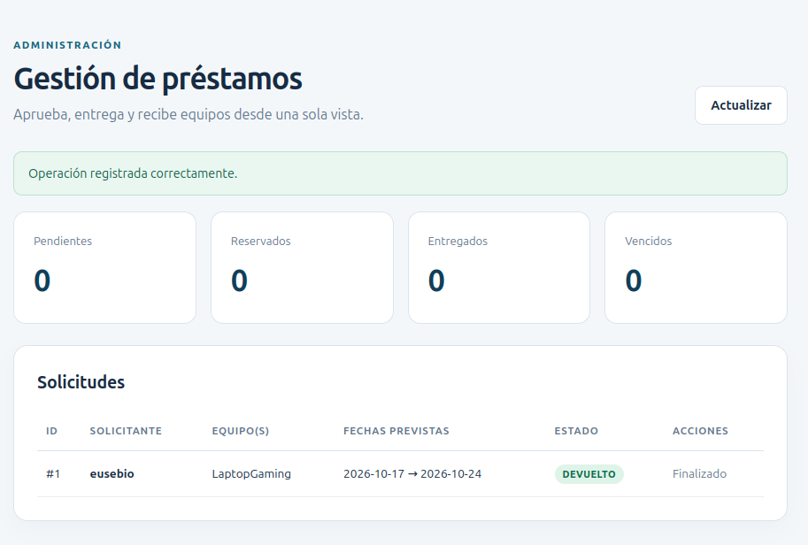

Las capturas muestran el cambio del **estado del préstamo** hasta `DEVUELTO`. Las reglas de disponibilidad están implementadas en el backend; si el profesor solicita comprobarlas directamente en el inventario o en PostgreSQL, conviene agregar también esa evidencia.

## 9. Persistencia y prueba de carga

Todavía me falta comprobar la persistencia después de reiniciar los contenedores y hacer una prueba de carga. Dejé los comandos en esta sección para ejecutarlos y agregar las capturas cuando termine ambas comprobaciones.

### 9.1 Persistencia de PostgreSQL después de un reinicio

Primero se guardan los registros de las tablas principales en un archivo local:

```bash
mkdir -p evidencias/unidad3/salidas

docker compose --env-file .env.unidad3 \
  -f compose.unidad3.yml exec -T db \
  psql -U labtrack -d labtrack_db -At -F '|' \
  -c "SELECT (SELECT COUNT(*) FROM usuarios),
             (SELECT COUNT(*) FROM categorias),
             (SELECT COUNT(*) FROM equipos),
             (SELECT COUNT(*) FROM prestamos);" \
  > evidencias/unidad3/salidas/antes_reinicio.txt
```

Después se reinician únicamente los contenedores de esta unidad:

```bash
docker compose --env-file .env.unidad3 \
  -f compose.unidad3.yml restart

docker compose --env-file .env.unidad3 \
  -f compose.unidad3.yml ps -a
```

Cuando vuelvan a estar saludables, se realiza la misma consulta y se comparan los resultados:

```bash
docker compose --env-file .env.unidad3 \
  -f compose.unidad3.yml exec -T db \
  psql -U labtrack -d labtrack_db -At -F '|' \
  -c "SELECT (SELECT COUNT(*) FROM usuarios),
             (SELECT COUNT(*) FROM categorias),
             (SELECT COUNT(*) FROM equipos),
             (SELECT COUNT(*) FROM prestamos);" \
  > evidencias/unidad3/salidas/despues_reinicio.txt

diff -u evidencias/unidad3/salidas/antes_reinicio.txt \
        evidencias/unidad3/salidas/despues_reinicio.txt
```

Si `diff` no encuentra cambios, se conservaron los conteos. También hay que revisar en el navegador que el préstamo devuelto siga en el historial para confirmar que no se trata solamente de una coincidencia en el número de registros.

### 9.2 Prueba de carga controlada sobre la API

Este ejemplo utiliza Python y realiza **40 consultas en total, como máximo cuatro simultáneas**, a la ruta de salud. Es una comprobación ligera para el laboratorio, no una prueba de capacidad de producción.

```bash
python3 - <<'PY'
from concurrent.futures import ThreadPoolExecutor, as_completed
from urllib.request import urlopen
from collections import Counter
from statistics import mean
from time import perf_counter

URL = 'http://127.0.0.1:4303/api/health/db'

def consultar(_):
    inicio = perf_counter()
    try:
        with urlopen(URL, timeout=10) as respuesta:
            respuesta.read()
            return respuesta.status, perf_counter() - inicio
    except Exception:
        return 'ERROR', perf_counter() - inicio

with ThreadPoolExecutor(max_workers=4) as grupo:
    resultados = list(grupo.map(consultar, range(40)))

codigos = Counter(estado for estado, _ in resultados)
tiempos = sorted(t * 1000 for _, t in resultados)
print('Resultados HTTP:', dict(codigos))
print(f'Tiempo promedio: {mean(tiempos):.1f} ms')
print(f'Tiempo máximo: {max(tiempos):.1f} ms')
print(f'Percentil 95 aprox.: {tiempos[37]:.1f} ms')
PY
```

Después de realizarla, el resultado y una captura de `docker stats` permitirán comparar el comportamiento de los contenedores antes y durante las peticiones. No se deben inventar resultados ni considerar un ensayo ligero como una evaluación exhaustiva de rendimiento.

## 10. Evidencias de la práctica

Extraje las capturas originales de mi documento de evidencias y las organicé en `evidencias/unidad3/capturas/`, para que se puedan abrir desde el README en GitHub.

| Archivo | Qué muestra |
|---|---|
| [01. Inicio de Compose](evidencias/unidad3/capturas/01_docker_compose_arranque.png) | Creación de red, volumen y contenedores |
| [02. Servicios iniciales](evidencias/unidad3/capturas/02_compose_servicios_iniciales.png) | Primer listado de los servicios desplegados |
| [03. Base de datos](evidencias/unidad3/capturas/03_api_base_datos_http_200.png) | API responde HTTP 200 desde Nginx |
| [04. HTTP y seguridad](evidencias/unidad3/capturas/04_frontend_200_y_ruta_401.png) | Frontend HTTP 200 y ruta privada HTTP 401 |
| [05. Login](evidencias/unidad3/capturas/05_pantalla_login.png) | Formulario de inicio de sesión |
| [06. Registro](evidencias/unidad3/capturas/06_registro_solicitante.png) | Formulario de registro de un solicitante |
| [07. Recursos](evidencias/unidad3/capturas/07_consumo_recursos_docker_stats.png) | Medición de memoria, CPU y procesos |
| [08. Equipos](evidencias/unidad3/capturas/08_gestion_equipos_admin.png) | Inventario y formulario de edición |
| [09. Categorías](evidencias/unidad3/capturas/09_gestion_categorias_admin.png) | Alta y listado de categorías |
| [10. Catálogo](evidencias/unidad3/capturas/10_catalogo_solicitante.png) | Equipo disponible para solicitar |
| [11. Solicitud](evidencias/unidad3/capturas/11_nueva_solicitud.png) | Formulario de préstamo |
| [12. Historial](evidencias/unidad3/capturas/12_mis_prestamos_pendiente.png) | Solicitud pendiente del solicitante |
| [13. Edición](evidencias/unidad3/capturas/13_edicion_prestamo.png) | Edición mientras está pendiente |
| [14. ADMIN: pendiente](evidencias/unidad3/capturas/14_admin_prestamo_pendiente.png) | Solicitud por aprobar o rechazar |
| [15. ADMIN: aprobado](evidencias/unidad3/capturas/15_admin_prestamo_aprobado.png) | Aprobación y reserva |
| [16. ADMIN: entregado](evidencias/unidad3/capturas/16_admin_prestamo_entregado.png) | Registro de la entrega |
| [17. ADMIN: devuelto](evidencias/unidad3/capturas/17_admin_prestamo_devuelto.png) | Recepción del equipo y finalización |

Las capturas de inicio y las de uso de la aplicación corresponden a distintos momentos de la práctica. Por ejemplo, la captura inicial muestra cero usuarios; después registré las cuentas con las que realicé el flujo de préstamo.

## 11. Dificultades que encontré

Durante esta actividad se me presentaron algunos problemas que tuve que resolver antes de continuar:

**El error de `npm ci`.** La primera construcción del frontend se detuvo porque `package.json` y `package-lock.json` no coincidían para la instalación que hacía Docker. El mensaje mencionaba los paquetes `@emnapi/core` y `@emnapi/runtime`. Ajusté la instalación y fijé npm 11.6.2 durante la construcción. Al repetirla, Angular compiló, pasaron sus dos pruebas y se creó la imagen.

**El token no llegaba al backend.** Después de levantar los tres contenedores pude entrar como ADMIN, pero el panel mostraba el mensaje «Se requiere un token Bearer». Revisé el interceptor de Angular y encontré que todavía estaba buscando la dirección antigua `http://127.0.0.1:3002/`. Lo cambié para que reconociera `/api/`, volví a construir solamente el frontend y recreé ese contenedor. Al entrar otra vez, el panel cargó sin el error.

**La espera de los servicios.** Al iniciar Docker, el frontend apareció durante unos segundos como `health: starting`. Volví a ejecutar `docker compose ps -a` después de la inicialización y comprobé que los tres contenedores estuvieran saludables. No fue necesario borrar el volumen ni reiniciar Docker Desktop.

Resolver estos detalles me sirvió para comprender mejor la diferencia entre ejecutar una aplicación directamente en Linux y ejecutarla distribuida entre varios contenedores.

## 12. Relación con la lista de cotejo

El instrumento de la Unidad III pide los ejercicios realizados en clase y una guía de despliegue sobre el proyecto trabajado en la unidad anterior.

| Apartado del instrumento | Valor | Dónde lo documenté / estado |
|---|---:|---|
| Actividad 1: ejercicios realizados en clase | 3 pts | Debo incorporar los ejercicios que haya revisado y solicitado el docente; no vienen dentro de estas capturas |
| Documentación y estructura de los contenedores | 1 pt | Secciones 3 y 4: tres servicios, red, volumen y funciones |
| Compilación y pruebas | 1 pt | Secciones 5 y 6: construcción, Jest, Vitest, HTTP e integración en navegador |
| Instalación y configuración | 1 pt | Sección 5 y enlaces a Dockerfiles, Nginx y Compose |
| Limitaciones de recursos | 1 pt | Sección 7: CPU, memoria, procesos y `docker stats` |
| Evidencia de funcionamiento y orquestación | 1 pt | Secciones 5, 8 y 10: salud de servicios y flujo de préstamos |
| Repositorio con archivos de orquestación | 1 pt | Repositorio publicado en https://github.com/RoxyRg/labtrack-unidad3-docker |
| SER: asistencia, actitud y portafolio | 1 pt | Se revisa en clase y lo valora el docente |
| **Total** | **10 pts** | **Calificación sujeta a revisión del profesor** |

Los comandos de la sección 9 están preparados, pero todavía tengo que ejecutarlos y guardar las salidas en las evidencias. Los ejercicios de clase también los agregaré cuando los termine.

## 13. Conclusión

En esta unidad aprendí a preparar el despliegue de una aplicación que ya tenía desarrollada. Antes iniciaba Angular y NestJS desde terminales diferentes y PostgreSQL tenía su propia configuración; ahora pude levantar los tres servicios con Docker Compose y abrir LabTrack desde un solo puerto en el navegador.

Lo que más se me complicó no fue crear los contenedores, sino hacer que funcionaran juntos. Primero apareció el problema de las dependencias al construir Angular y luego el detalle del JWT, porque había cambiado la dirección de la API. Cuando corregí eso comprobé que podía entrar al panel del administrador, registrar equipo y terminar un préstamo hasta su devolución.

También pude observar cuánto recurso estaba utilizando cada contenedor y dejar límites para que esta práctica no interfiera con los otros proyectos que tengo en mi computadora. Entendí mejor para qué sirven las redes internas de Docker, los healthchecks y los volúmenes de datos. Considero que el avance más importante fue pasar de tener una aplicación que funcionaba solamente en mi entorno de desarrollo a una que puedo iniciar y revisar de manera más ordenada con Compose.

**Méndez Fernández Alan Eusebio**

*Ingeniería en Redes Inteligentes y Ciberseguridad — GIRI6091*

## 14. Referencias

- Material del profesor: *Lista de cotejo — Unidad III, Interfaces de programación de aplicaciones en la automatización de redes*, Automatización de Infraestructura Digital I.
- Caso de estudio de la Unidad II: *LabTrack — Sistema de préstamo de equipo de laboratorio*.
- Docker. *Docker Compose*. https://docs.docker.com/compose/
- Docker. *Dockerfile reference*. https://docs.docker.com/reference/dockerfile/
- Docker. *Resource constraints*. https://docs.docker.com/engine/containers/resource_constraints/
- Nginx. *Documentation*. https://nginx.org/en/docs/
- Angular. *Documentation*. https://angular.dev/
- NestJS. *Documentation*. https://docs.nestjs.com/
- Prisma. *Prisma Migrate*. https://www.prisma.io/docs/orm/prisma-migrate
- PostgreSQL. *Documentation*. https://www.postgresql.org/docs/
